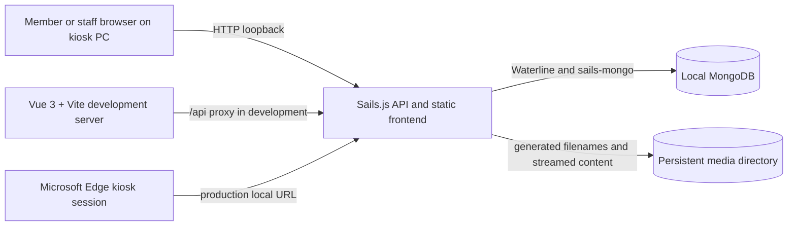

# Architecture

## Runtime topology

All production services are on one Windows computer. Sails is the local HTTP origin for both the built SPA and `/api/v1`. In development, Vite serves the SPA on `127.0.0.1:5173` and proxies `/api` to Sails on `127.0.0.1:1337`. MongoDB is reached only through a local MongoDB URI. The production launcher rejects a non-loopback host and a non-loopback MongoDB URI.

There is no internet requirement, cloud service, remote media host or second computer in the runtime path. Update/build inputs may be transferred offline by an operator.

## Request and data flow

1. Vue Router selects a member or admin view.
2. Frontend API modules call same-origin `/api/v1` endpoints (or Vite's development proxy).
3. Sails routes select controllers and explicit admin/CSRF middleware. Services own catalog, authentication, media, floor-plan and settings logic.
4. Sails uses Waterline models and the MongoDB driver exposed through `sails-mongo`; boot creates required indexes and cleans interrupted media uploads.
5. Structured data and media metadata live in MongoDB. Binary files live in the local media directory and are streamed by the API.

Public member routes do not require login. Admin operations use the session cookie and CSRF token. Sails blueprints are disabled; only declared routes are intended to be exposed.

## Main boundaries

- `apps/web`: Vue pages, reusable components, router, localization, API modules and styles. UI components should not own database/business rules.
- `apps/api/api/controllers`: HTTP input/output and status handling.
- `apps/api/api/services`: catalog queries, auth, media lifecycle, indexes and floor-plan behavior.
- `apps/api/api/models`: Waterline field validation and collection mappings.
- `apps/api/config`: Sails routing, datastore, session, policies, environment and startup configuration.
- `deployment/windows`: installer source, service templates and operator scripts. These are deployment aids, not application runtime code.

## Catalog versus gym data

Muscle groups, equipment types, exercises, variations and exercise relationship records are reusable catalog content. `gymEquipment`, `gymFloorPlans`, `floorPlanMarkers`, gym settings and `adminUsers.gymId` are scoped to a gym. This supports a later multi-gym service but the current kiosk configuration selects one gym through `GYMGUIDE_GYM_ID`; cross-gym login management and synchronization are not present.

## Maps and media

An uploaded floor-plan image is a media asset referenced by a gym floor-plan record. Physical equipment markers refer to a gym equipment unit and store normalized `x`/`y` values in the image coordinate space (0 to 1). Member map views use the shared floor-plan canvas to scale the actual image and markers without altering those stored values.

Media metadata (generated storage name, original name, MIME type, size, checksum and status) is in MongoDB. Content bytes are under `<GYMGUIDE_MEDIA_DIR>/files`; temporary uploads are under `.incoming`. Backups must contain both MongoDB and this directory from the same quiescent point.

## Persistence and recovery

Development defaults to `gymguide_dev` and repository-root `data/media`. Production requires an explicitly named non-development MongoDB database and an absolute media path outside the versioned application directory. Startup does not seed or reset content. The production runner waits for MongoDB's TCP port, shows a local startup page, starts Sails, and retries after process exit. A successful `/api/v1/health` response pings MongoDB; a TCP-open check alone is not proof of database readiness.

Prepared Windows scripts configure an app service wrapper, local paths, paired backup/restore, and versioned updates. They have not been proven by real kiosk/power-loss acceptance; use [Windows deployment](DEPLOYMENT-WINDOWS.md) and the operator guide for limits.

## Deliberate limits

- The current admin account roles are `gym-admin` and `gym-staff`; there is no implemented platform administrator role.
- Admin sessions and login throttling are process-local. Restarting Sails requires staff to sign in again and resets the in-memory login rate-limit window.
- Current installation is a single selected gym, even though content ownership is separated in the schema.
- No cloud synchronization, automatic scheduled backup, remote administration or remote telemetry is implemented.
